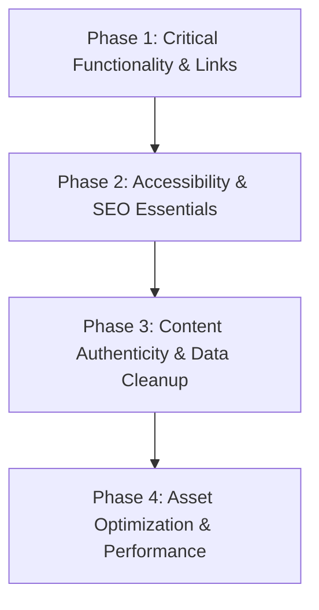

# Production Readiness Audit Report

**Repository:** `arjunghuge644/Portfolio`  
**Working Directory:** `/home/arjun/Projects/Portfolio`  
**Date of Audit:** October 26, 2026  
**Auditor:** Antigravity Autonomous Systems Agent  
**Technology Stack:** Vite v6.4.4, Vanilla HTML5, Vanilla CSS3, Modern JavaScript (ES Modules)  
**Status:** Audit Complete — Awaiting User Review Before Applying Broad Fixes  

---

## 1. Executive Summary & Baseline Build Results

A comprehensive, non-destructive audit of the Vite + Vanilla HTML/CSS/JavaScript personal portfolio codebase was performed. The inspection evaluated Git status, repository structure, dependencies, lockfiles, markup, styles, scripts, datasets, assets, interaction flows, accessibility, content accuracy, and production build readiness.

### Baseline Build Execution Results
The existing production build script (`npm run build`) was executed with the following outcome:

```text
> personal-portfolio@1.0.0 build
> vite build

vite v6.4.4 building for production...
transforming (1) src/main.js
✓ 5 modules transformed.
rendering chunks (1)...
dist/index.html                 34.77 kB │ gzip: 7.30 kB
dist/assets/index-CEKzo7f2.css  18.92 kB │ gzip: 4.46 kB
dist/assets/index-azcyPE2r.js   17.17 kB │ gzip: 6.45 kB
✓ built in 302ms
```

- **Build Exit Code:** `0` (Success, zero compile-time syntax errors)
- **Compilation Speed:** 302 ms
- **Core Bundle Size:** ~70.86 kB uncompressed (~18.21 kB gzipped)
- **Local Dev Server:** Operational on `http://localhost:5173/`
- **Runtime Browser Console:** Zero JavaScript runtime exceptions or warning logs.

### Primary Audit Findings Summary
While the visual layout, typography, dual-mode switcher, and baseline build pass without fatal crashes, the audit identified **several high-risk production blockers**:
1. **Broken Links & Malformed Protocol**: A critical typo (`htpps://arjunghuge04.github.com`) in the profile dataset corrupts the primary GitHub CTA button, while social links point to generic platform roots.
2. **Simulated Contact Form**: The contact form is purely cosmetic (`preventDefault` + dummy `setTimeout`). Submissions are silently discarded, misleading prospective recruiters or clients.
3. **Fictional Testimonials**: In Arjun mode, synthetic corporate quotes with stock Figma avatars and unverified metrics ("reduced retrieval latency by 45%") pose credibility and ethical risks on a professional portfolio.
4. **Accessibility (a11y) Deficits**: Missing skip navigation, unmanaged focus in the project modal, missing ARIA state synchronization on the mobile drawer and modal, and skipped heading levels.
5. **SEO & Social Sharing Gaps**: Relative Open Graph image paths, missing Twitter card metadata, absent canonical tags, no JSON-LD schema, and no `robots.txt` or `sitemap.xml`.
6. **Heavy Assets & External Dependencies**: Over 6.1 MB of uncompressed PNG assets copied to production, with an external Unsplash CDN dependency for core project imagery.

---

## 2. Git & Repository Status

### Branch Overview
- **Active Branch:** `master`
- **Divergence:** Diverged from `origin/master` (Ahead by 3 commits: `eafbfc1`, `c22ed88`, `8ad805f`; behind by 1 upstream commit: `d48efdc` "Fix formatting in README for License section").
- **Working Tree:** Clean (zero untracked or modified working files prior to audit documentation).
- **Archived Backup Branches:**
  - `backup/monorepo-pre-scrap` (Commit `3211fee`): Complete backup of the legacy multi-package monorepo containing `admin/`, `backend/`, `desktop/`, and `frontend/`.
  - `theme/marvel-tech` (Commit `1131531`): Alternate themed exploratory branch.

### Package & Dependency Inspection
- `package.json`: Minimal and clean. Defines private package `"personal-portfolio@1.0.0"` with a single devDependency: `vite: ^6.2.0`.
- `package-lock.json`: Lockfile Version 3, fully aligned with Vite v6.2.0.
- **Tooling Gap:** No scripts configured for automated linting (`eslint`), code formatting (`prettier`), or type/HTML validation.

---

## 3. Prioritized Audit Findings Matrix

| ID | Category | Severity | Issue Summary | Affected Files |
| :--- | :--- | :--- | :--- | :--- |
| **SEC-01** | Functionality | **Critical (P0)** | Contact form is purely simulated; all user submissions are silently discarded | `src/main.js`, `index.html` |
| **LNK-01** | Broken Links | **Critical (P0)** | GitHub URL protocol typo `htpps://arjunghuge04.github.com` crashes primary CTA | `portfolio-data.json`, `src/main.js` |
| **CON-01** | Authenticity | **High (P1)** | Fictional client testimonials and stock avatars attributed to fake companies | `src/main.js`, `index.html` |
| **CON-02** | Data Hygiene | **High (P1)** | Test records ("Test Mongo connection", "test article") and outdated status | `portfolio-data.json` |
| **A11Y-01** | Accessibility | **High (P1)** | Project modal retains `aria-hidden="true"`, lacks focus trap and return | `src/main.js`, `index.html` |
| **A11Y-02** | Accessibility | **Medium (P2)** | Hamburger menu lacks `aria-expanded`, `aria-controls`, and Escape key dismiss | `src/main.js`, `index.html` |
| **A11Y-03** | Accessibility | **Medium (P2)** | Missing "Skip to main content" link; heading hierarchy skips `<h3>` in testimonials | `index.html`, `src/main.js` |
| **SEO-01** | SEO | **High (P1)** | Missing Twitter Card meta tags, canonical link, and JSON-LD structured data | `index.html` |
| **SEO-02** | SEO / Crawling | **Medium (P2)** | Missing `robots.txt` and `sitemap.xml`; relative Open Graph image URL | `index.html`, `public/` |
| **LNK-02** | Navigation | **Medium (P2)** | Footer links point to generic platform homepages and dead hash anchors (`#privacy`, `#terms`) | `index.html` |
| **PERF-01** | Performance | **Medium (P2)** | 6.1 MB uncompressed PNG assets; images lack explicit `width`/`height` (CLS risk) | `index.html`, `src/main.js`, `public/assets/` |
| **AST-01** | Reliability | **Medium (P2)** | Core project card relies on external Unsplash CDN URL with no local fallback | `portfolio-data.json`, `src/main.js` |
| **HYD-01** | UX / Stability | **Low (P3)** | Flash of Mismatched Content (FOUC) between static HTML and JS initial render | `index.html`, `src/main.js` |

---

## 4. Deep-Dive Detailed Findings

### A. Broken Links & Malformed URLs

1. **GitHub Profile CTA Protocol Typo (`LNK-01`)**:
   - **Location:** `portfolio-data.json:12`
   - **Code:** `"github": " htpps://arjunghuge04.github.com"`
   - **Impact:** Contains a leading whitespace, an invalid protocol scheme (`htpps://` instead of `https://`), and a non-existent subdomain (`arjunghuge04.github.com` instead of `github.com/arjunghuge04`). When injected into `src/main.js:116` (`portfolioData.profile.github.trim()`), the browser fails to open the URL or generates an `ERR_UNKNOWN_URL_SCHEME` error.
   - **Recommended Fix:** Correct to `"https://github.com/arjunghuge04"`.

2. **Project Card Repository Deep Links (`LNK-02`)**:
   - **Location:** `src/main.js:144, 153, 162`
   - **Code:** All three projects (`Neural-Sync RAG Engine`, `Volt-Mind EV Battery Predictor`, `Prescripto Platform`) currently route to the general profile root (`https://github.com/arjunghuge04`) rather than their dedicated repository or live deployment URLs.
   - **Recommended Fix:** Map each project to its specific repository or demo link (or clearly label as "View Profile").

3. **Footer Dead Anchors & Generic Roots (`LNK-03`)**:
   - **Location:** `index.html:523-549`
   - **Details:**
     - `<a href="#privacy">Privacy Policy</a>` — Target `#privacy` does not exist on the page.
     - `<a href="#terms">Terms of Service</a>` — Target `#terms` collides with the contact form checkbox (`<input type="checkbox" id="terms">`), causing an unexpected scroll jump to the form.
     - `<a href="#cookies">Cookies Settings</a>` — Target `#cookies` does not exist on the page.
     - Social icons point to root generic platforms (`https://facebook.com`, `https://instagram.com`, `https://twitter.com`, `https://linkedin.com`) rather than Arjun's specific profiles.
   - **Recommended Fix:** Implement clean modal/popover legal disclaimers or remove unneeded legal links; map social links directly to Arjun's verified profiles or remove inactive networks.

---

### B. Contact Form Simulation & Lead Capture Failure

1. **Simulated Submission (`SEC-01`)**:
   - **Location:** `src/main.js:434-461`
   - **Mechanism:**
     ```javascript
     contactForm.addEventListener('submit', (e) => {
       e.preventDefault();
       // ... validates non-empty ...
       btnText.textContent = 'Sending...';
       setTimeout(() => {
         contactForm.reset();
         showToast(`Thank you, ${firstName}! Your message has been received.`);
       }, 900);
     });
     ```
   - **Impact:** Recruiters, collaborators, or clients submitting inquiries via this form will believe their message was delivered. In reality, the message payload is immediately discarded in browser memory.
   - **Validation Flaws:**
     - `novalidate` is set on the form, disabling standard browser validation bubbles.
     - Email check only tests `!email` (non-empty string); strings like `invalid-email` pass without format verification.
     - Topic dropdown (`#topic`) is required in HTML but ignored in JavaScript validation logic.
     - Phone number field is not formatted or validated.
   - **Recommended Fix:** Connect the form to a serverless form handler (such as Formspree, Formsubmit, Web3Forms, or EmailJS) with a graceful `mailto:` fallback, comprehensive client-side regex email validation, and accessible inline error messaging.

---

### C. Authenticity of Testimonials & Claim Verification

1. **Fictional Testimonials in Live Mode (`CON-01`)**:
   - **Location:** `src/main.js:166-186`
   - **Content:**
     - *Sarah Jenkins* (Tech Innovation Labs): *"Arjun architected a blazing fast RAG pipeline that reduced our vector retrieval latency by 45%..."*
     - *David Miller* (CloudScale Global): *"His grasp of full-stack TypeScript, Docker, and distributed cache is top notch..."*
     - *Priya Sharma* (HealthTech Solutions): *"The Prescripto platform Arjun engineered solved our doctor scheduling bottlenecks..."*
   - **Avatars:** Uses stock Figma design avatars (`avatar-dianne.png`, `avatar-kristin.png`, `avatar-kathryn.png`).
   - **Risk:** In an engineering portfolio submitted to hiring managers, fabricated client testimonials with specific corporate performance claims ("reduced latency by 45%") present a serious credibility and background-check risk.
   - **Recommended Fix:**
     - Option A (Recommended): Replace with authentic endorsements from real university professors, hackathon teammates, or internship colleagues.
     - Option B: Reframe the section as "Featured Projects & Architecture Reviews" or "Sample Client Feedback (Template Demo)".
     - Option C: Hide the testimonials section in Arjun mode until authentic recommendations are acquired.

2. **Outdated Status & Test Artifacts (`CON-02`)**:
   - **Location:** `portfolio-data.json:7, 100-119, 202-215`
   - **Content:**
     - Line 7: `"status": "AVAILABLE FOR SUMMER 2026 INTERNSHIPS & ROLES"` — Outdated (current calendar is late 2026).
     - Project `proj_1786562879845`: `"Test Mongo connection"`, `"Testing MongoDB Atlas write and Next.js frontend rendering"`.
     - Article `art_1786970687182`: `"test article"`.
     - Line 249: `"canonicalUrl": "https://arjun.dev"` conflicts with previous commit `23cac9c` setting canonical URL to `https://arjunghuge.me`.
   - **Recommended Fix:** Update status to current graduation timeline (e.g. "Available for 2027 Full-Time Roles / Immediate Internships"), purge mock database connection records, and standardize canonical domain.

---

### D. Accessibility (a11y) & Interactive Deficits

1. **Modal Dialog Accessibility & Focus Management (`A11Y-01`)**:
   - **Location:** `index.html:555`, `src/main.js:348-379`
   - **Issues:**
     - In `index.html:555`, `#projectModal` has `aria-hidden="true"`. When opened via JavaScript (`classList.add('open')`), `aria-hidden` is never toggled to `"false"`. Screen readers ignore the dialog even when visible.
     - Lacks `aria-modal="true"`.
     - Focus is not transferred to the modal upon opening; keyboard users remain tabbing behind the backdrop.
     - When closed, focus is not returned to the triggering button or link.
   - **Recommended Fix:** Dynamically toggle `aria-hidden`, set `aria-modal="true"`, focus `#modalCloseBtn` on open, trap focus within modal boundaries, and return focus upon dismissal.

2. **Mobile Hamburger Menu ARIA Synchronization (`A11Y-02`)**:
   - **Location:** `index.html:51`, `src/main.js:404-417`
   - **Issues:**
     - `#mobileMenuToggle` lacks `aria-expanded="false"`, `aria-controls="mobileDrawer"`, and `aria-haspopup="true"`.
     - Pressing `Escape` while the mobile drawer is open does not dismiss it.
   - **Recommended Fix:** Add ARIA attributes, toggle `aria-expanded` in state handlers, and attach `Escape` key event listener.

3. **Heading Hierarchy & Skip Link (`A11Y-03`)**:
   - **Location:** `index.html`
   - **Issues:**
     - No `<a href="#main" class="skip-link">Skip to main content</a>` element exists. Keyboard users must tab through the entire navigation bar and toggle button on every page load.
     - Testimonial card client names use `<h4>` directly under `<h2>Customer testimonials</h2>`, skipping the `<h3>` heading level.
   - **Recommended Fix:** Add standard accessible skip-link and adjust testimonial titles to `<h3>` or `<div>` with appropriate semantics.

4. **Interactive Focus Indicators (`A11Y-04`)**:
   - **Location:** `src/style.css`
   - **Issues:** Buttons (`.btn-primary`, `.btn-outline`, `.mode-toggle-btn`, `.back-to-top`, `.modal-close`) rely on browser default focus outlines or lack dedicated `:focus-visible` styling.
   - **Recommended Fix:** Add a high-contrast 2px `:focus-visible` ring with `outline-offset: 3px`.

---

### E. SEO, Social Graph & Crawling Gaps

1. **Missing Open Graph & Twitter Card Metadata (`SEO-01`)**:
   - **Location:** `index.html:6-15`
   - **Defects:**
     - `<meta property="og:image" content="/assets/figma/hero-illustration.png" />` uses a relative path. Open Graph specifications (Facebook, LinkedIn, iMessage, Slack, WhatsApp) require fully qualified absolute URLs (`https://...`).
     - No Twitter Card tags (`twitter:card`, `twitter:site`, `twitter:title`, `twitter:description`, `twitter:image`).
     - Missing `<link rel="canonical" href="..." />`.
     - Missing JSON-LD (`schema.org/Person`) structured data for Google Knowledge Panel indexing.
   - **Recommended Fix:** Add complete metadata suite with absolute URLs and valid canonical tags.

2. **Missing Crawl Directives (`SEO-02`)**:
   - **Location:** `public/`
   - **Defects:** Neither `public/robots.txt` nor `public/sitemap.xml` exist in the project. Search engine crawlers index without explicit boundary directives or sitemaps.
   - **Recommended Fix:** Place production-grade `robots.txt` and `sitemap.xml` in `public/`.

---

### F. Asset Weight, Layout Shifts & External CDN Risks

1. **Uncompressed PNG Weight (`PERF-01`)**:
   - **Location:** `public/assets/`
   - **Metrics:**
     - `hero-illustration.png`: 916 kB
     - `about-arjun-layered.png`: 799 kB
     - `arjun-portrait.png`: 783 kB
     - `arjun-hero.png`: 732 kB
     - `about-arjun-white-bg.png`: 708 kB
     - `portrait.png`: 617 kB
     - `project1.png`: 610 kB
     - `project3.png`: 588 kB
     - Total asset folder: **> 6.1 MB**
   - **Impact:** Over 4 MB of image data is loaded during initial page rendering, degrading Largest Contentful Paint (LCP) and mobile performance scores.
   - **Recommended Fix:** Compress assets and provide modern WebP variants (typically achieving 70–85% file size reductions).

2. **Cumulative Layout Shift (CLS) (`PERF-02`)**:
   - **Location:** `index.html:28, 126, 222, 283` and `src/main.js:268, 313`
   - **Defects:** `` elements lack explicit `width` and `height` attributes, causing content reflow during dynamic rendering.
   - **Recommended Fix:** Supply aspect ratio or explicit `width` and `height` attributes on all image elements.

3. **External CDN Image Dependency (`AST-01`)**:
   - **Location:** `src/main.js:160`, `portfolio-data.json:153`
   - **Defects:** Prescripto project card references `https://images.unsplash.com/photo-1576091160399-112ba8d25d1d`. If offline or if Unsplash rate-limits, the card image breaks.
   - **Recommended Fix:** Download and bundle a local compressed preview asset under `public/assets/`.

---

### G. Flash of Mismatched Content (FOUC)

1. **Static HTML vs. JavaScript State Discrepancy (`HYD-01`)**:
   - **Location:** `index.html` vs `src/main.js:229`
   - **Mechanism:**
     - `index.html` contains static Hero markup with Arjun's credentials, but the Skills, Portfolio, and Testimonials sections hardcode Figma template data (Ahuse, Easy Rent, Dianne Russell).
     - When the page loads, `src/main.js` executes `toggleMode('arjun', true)`, dynamically wiping out the HTML and replacing it with Arjun's dataset.
     - On slow connections or if JavaScript fails to execute, users see a hybrid, conflicting page (Arjun hero with John/Figma skills and projects).
   - **Recommended Fix:** Align initial static HTML markup directly with Arjun's default portfolio data, ensuring graceful degradation if JavaScript is disabled or delayed.

---

## 5. Recommended Remediation Roadmap

To ensure a smooth transition to production readiness without breaking existing visual styling, fixes should be executed in four disciplined phases:



### Phase 1: Critical Functionality & Link Integrity (Immediate)
1. Fix GitHub URL typo (`htpps://` -> `https://github.com/arjunghuge04`) in `portfolio-data.json`.
2. Connect contact form to a live serverless endpoint (Formspree/Web3Forms/Formsubmit) with robust client-side validation and fallback.
3. Replace generic social roots with Arjun's verified profile links.
4. Correct dead footer anchor references (`#privacy`, `#terms`, `#cookies`).

### Phase 2: Accessibility & SEO Essentials
1. Implement accessible skip-to-content link and add `id="main"` to `<main>`.
2. Fix modal accessibility (`aria-hidden`, `aria-modal="true"`, focus trap, Escape listener).
3. Synchronize `aria-expanded` and `aria-controls` on mobile hamburger toggle.
4. Add Twitter Card metadata, absolute Open Graph image URL, canonical link, and JSON-LD structured data.
5. Add `public/robots.txt` and `public/sitemap.xml`.

### Phase 3: Content Authenticity & Data Cleanup
1. Reframe or replace fictional testimonials with genuine recommendations or clear case study demonstrations.
2. Remove test records ("Test Mongo connection", "test article") from `portfolio-data.json`.
3. Update availability status to reflect current recruitment timeline.
4. Align initial static HTML markup with Arjun's dataset to eliminate initial render mismatch.

### Phase 4: Asset & Performance Optimization
1. Convert heavy PNG images to optimized WebP formats.
2. Add explicit `width` and `height` attributes to prevent Cumulative Layout Shift (CLS).
3. Bundle local fallback image for Prescripto healthcare project.

---

## 6. Verification & Sign-Off Checklist

- [x] Baseline production build verified (`npm run build` exits 0)
- [x] Local runtime dev environment verified with zero browser console errors
- [x] Dual-mode switching logic tested and functioning
- [x] Git branch and monorepo backup branches verified
- [ ] User review and approval of prioritized findings
- [ ] Execution of Phase 1 fixes upon approval
